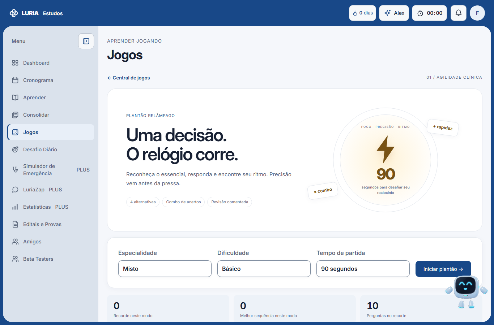
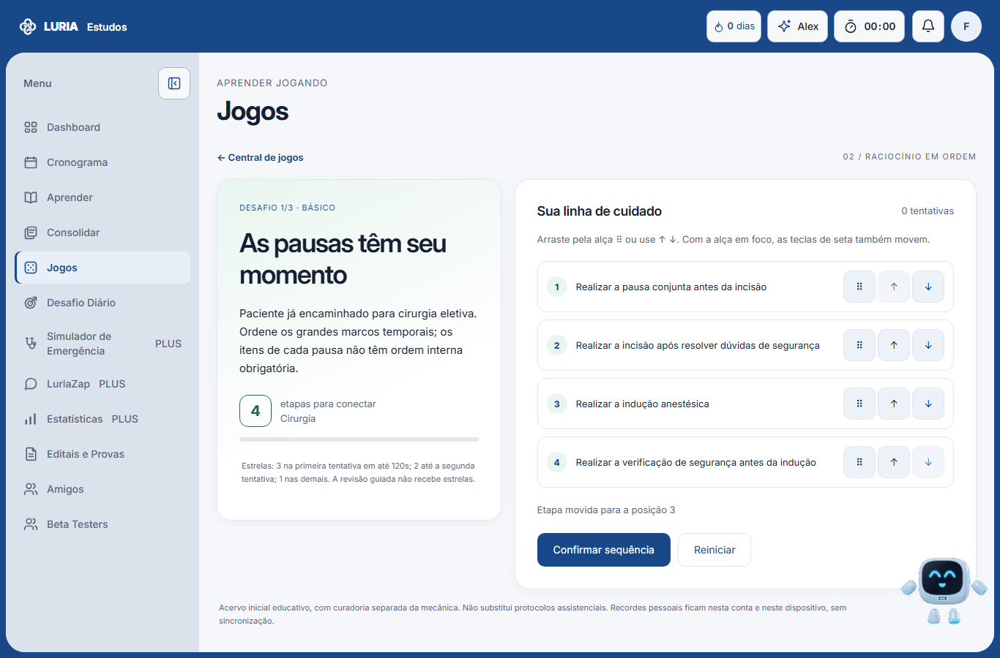
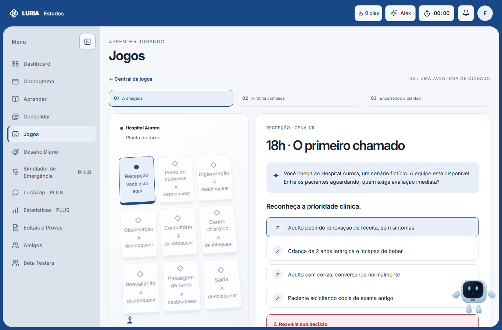
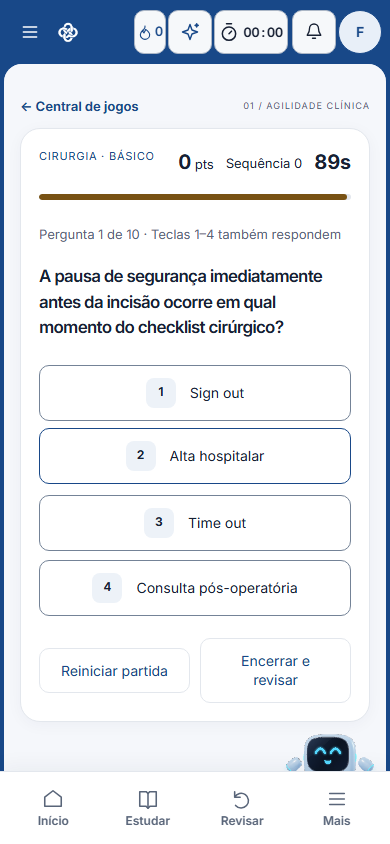
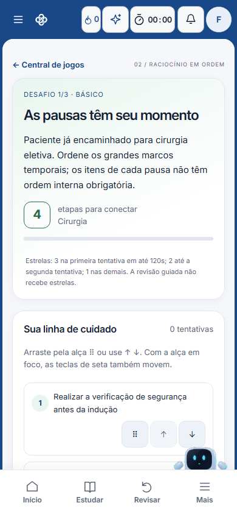
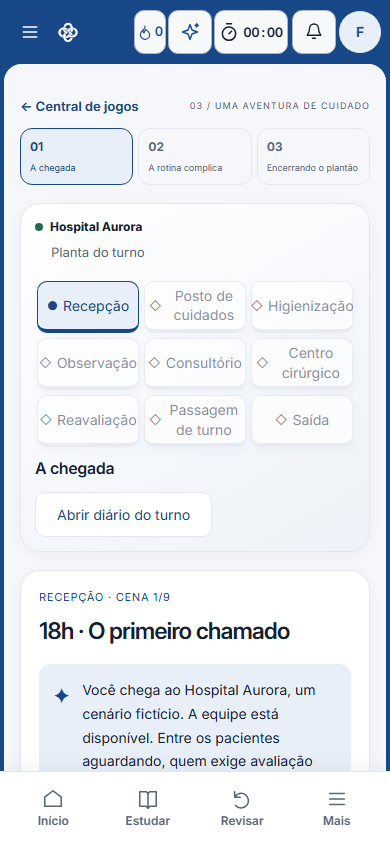

# Central de jogos TRAUBE — implementação para revisão

Três experiências individuais implementadas em HTML, CSS, SVG e JavaScript nativos, com links ativos na central. Branch `feat/central-jogos-completa`, baseada em `d7dc563786147a089a71d264247ad899d6e57576`. Não houve merge ou publicação em produção.

## Funcionalidades concluídas

| Jogo | Mecânica e entrega |
| --- | --- |
| Plantão Relâmpago | Partidas de 60/90/120 segundos, cinco especialidades e misto, três dificuldades, quatro alternativas, cronômetro por prazo absoluto, bônus de rapidez, combos, bloqueio de respostas duplicadas, resultados, revisão comentada e recordes por recorte. |
| Sequência Salvadora | Desafios com 4 a 7 etapas, arraste por ponteiro e toque, botões e setas do teclado, validação de ordens equivalentes, posições corretas, primeira divergência, tentativas, tempo, pontos, estrelas, revisão guiada e conclusão do conjunto. |
| Escapando do Plantão | Hospital vetorial e mapa de salas, nove cenas em três capítulos, escolhas de conduta, seleção de achados, minissequências, desbloqueio progressivo, feedback com nova tentativa, diário, pendências, avaliação final e reinício. |

Os três jogos incluem retorno à central, estados vazios, adaptação às quatro combinações de identidade/aparência, áreas seguras e redução de movimento. A troca de conta descarta a partida ativa. Eventos locais `traube:game-completed` preparam futura integração sem gravar resultados no backend.

## Reconhecimento e integração

- Foram inspecionadas as páginas Aprender, Consolidar, Estatísticas, Jogos e Study Rats, os estilos globais e o shell v2. A plataforma usa páginas estáticas e scripts compartilhados; o build de GitHub Pages copia os arquivos públicos rastreados pelo Git.
- `ui-app.css` fornece tokens de quatro temas, navegação e camadas CSS. As novas folhas têm seletores restritos a `.traube-game`. As correções de tipografia utilizam a camada existente apenas dentro dessas raízes.
- As páginas novas mantêm o mesmo `data-page="jogos"`, carregam `app.js`, `supabase.js`, `ui-theme-v2.js`, `ui-navigation-v2.js` e `pwa.js`. O jogo inicializa após a autenticação existente (`docmap:ready`). Nenhuma nova regra de acesso foi criada.
- `TraubeLocalOwnerStore` já fornece armazenamento vinculado à conta. Foram adicionados apenas recordes locais, sem fallback para um armazenamento compartilhado entre usuários. Falha de armazenamento não impede jogar e é informada no resultado.
- Flashcards possuem `front_text`/`back_text`, metadados de especialidade e bibliotecas pessoais/sistema/compartilhadas. Existem pacotes públicos em `content/weekly/`. As questões têm fluxos próprios de importação/geração/revisão; `clinical_protocols` armazena protocolos com seções e decisões. Não existe nesses formatos uma garantia automática de quatro distratores adequados ou de ordem clínica exclusiva.
- Por essa razão, esta versão usa **conteúdo local inicial**, separado do motor: 30 perguntas, nove sequências e nove cenas. Não há integração de conteúdo privado, conversão automática de flashcards ou cópia de questões de bancos externos. A interface informa esse limite.
- Os recursos específicos só são solicitados ao abrir cada página. O único ajuste no service worker acrescenta a central e as três rotas à lista pública e atualiza sua versão. Não aumenta o conjunto de instalação antecipada nem armazena dados clínicos privados. A recuperação offline verificada é dos recursos públicos após visita; a autenticação offline completa continua dependente do comportamento global existente.
- A CSP permanece com scripts de mesma origem, sem handlers inline, sem relaxamento de RLS ou permissão adicional. As três páginas foram registradas no inventário existente de CSP.

## Conteúdo e critérios

Fontes consultáveis incluem Ministério da Saúde, Anvisa, Sociedade Brasileira de Diabetes, OMS e CDC; cada item aponta as fontes pertinentes na revisão. Exemplos: [correção da hipoglicemia — SBD](https://diabetes.org.br/hipoglicemia-qual-a-melhor-forma-de-corrigir/), [higiene das mãos — Anvisa](https://www.gov.br/anvisa/pt-br/centraisdeconteudo/publicacoes/servicosdesaude/publicacoes/protocolo-de-higiene-das-maos), [cirurgia segura — OMS](https://www.who.int/teams/integrated-health-services/patient-safety/research/safe-surgery/tool-and-resources) e [condições agudas na infância — MS](https://linhasdecuidado.saude.gov.br/portal/puericultura/unidade-de-atencao-primaria/condicoes-agudas/index.php).

As sequências delimitam os marcos avaliados, agrupam intervenções simultâneas e aceitam variantes explicitamente cadastradas. A resposta recomendada não é apresentada antes de uma tentativa. Após três erros, o jogador pode escolher revisão guiada, sem receber estrelas ou pontuação pelo desafio.

Pontuação configurada em cada motor:

- Relâmpago: 100 por acerto, até 50 pela rapidez em uma janela de 12 segundos, multiplicador 1,25 a partir de três acertos e 1,5 a partir de cinco. Erro zera a sequência. Perguntas não são recicladas na mesma partida.
- Sequência: 500 pela resolução, até 200 pela posição inicial dos cartões, até 150 pelo tempo, menos 100 por tentativa extra, com piso zero. Três estrelas na primeira tentativa dentro de 30 segundos por etapa; duas até a segunda tentativa; uma nas demais resoluções; zero na revisão guiada.
- Aventura: 150 por cena resolvida, menos 35 por tentativa adicional, mínimo 25. A precisão inicial considera a primeira tentativa, e os pontos de atenção registram as cenas em que houve erro.

## Verificação

| Verificação | Resultado |
| --- | --- |
| `node --test tests/games.test.cjs` | 13/13 testes aprovados: integridade de conteúdo, bloqueios, cronômetro, acervo esgotado, ordenação, progressão, revisão guiada, falha de armazenamento, troca de conta, CSP e cache público. |
| Playwright / Chromium | Fluxos completos dos três jogos, revisão, resultados, reinício, retorno, expiração, teclas, arraste por ponteiro e toque. Conta de teste com fixture existente; nenhuma operação no Supabase real. |
| Responsividade e temas | 390, 768, 1366 e 1920 px; quatro combinações de azul/rosa e claro/escuro. Sem rolagem horizontal na matriz verificada. Capturas reais do shell e dos jogos. |
| PWA em smartphone emulado | Shell instalado, três telas de partida sem excesso horizontal e arraste por toque aprovados. Não equivale a teste físico em iOS/Android. |
| Regressão no navegador | Abertura autenticada de Dashboard, Aprender, Consolidar, Estatísticas, Amigos, Study Rats e Simulador de Emergência. Login sem sessão redireciona para a rota existente. É um smoke test, não uma homologação integral de todos os fluxos dessas áreas. |
| Sintaxe e CSS | Sem erros nos verificadores existentes. |
| Build público | `node scripts/build-pages.cjs` preparou 647 recursos, incluindo todas as novas páginas e seus assets. |
| Suíte completa | 619/627 aprovados. As oito falhas finais também ocorreram na cópia limpa de comparação; nenhum novo nome de falha. A comparação limpa teve 600/611 aprovados e 11 falhas. |
| `npm run check` | Sintaxe e CSS passam; para nas divergências preexistentes dos prompts administrativos. A suíte foi executada separadamente. |

As oito falhas finais da suíte geral são: captura de fallback de imagens em apostilas; inventário CSP com contagem fixa de 96 páginas; proteção de URLs na fila Admin; proteção de URLs em figuras/lightbox; preferência antiga do Dashboard em PWA; sincronização de prompts nas duas rotas Admin; duas expectativas antigas sobre precache do service worker. Não foram alterados esses módulos para forçar a suíte a passar.

Uma execução intermediária sob concorrência encerrou por timeout no hook compartilhado que gera staging. A execução final foi repetida sem essa concorrência e produziu os totais acima.

## Arquivos

Criados:

- `jogos/plantao-relampago/index.html`
- `jogos/sequencia-salvadora/index.html`
- `jogos/escapando-do-plantao/index.html`
- `assets/css/games-common.css`, `games-relampago.css`, `games-sequencia.css`, `games-escape.css`
- `assets/js/games/common.js`, `relampago.js`, `sequencia.js`, `escape.js`
- `assets/js/games/content/initial.js`
- `tests/games.test.cjs`, `tests/games.browser.cjs`
- Este relatório e capturas selecionadas em `docs/jogos/`.

Modificados: `jogos/index.html` (cards e integração mínima de URL), `scripts/csp-pages.cjs` (registro das páginas) e `service-worker.js` (rotas e versão).

**Study Rats, seu tabuleiro, jogo competitivo dos grupos, Simulador de Emergência, menu lateral, autenticação, assinaturas, permissões, estilos globais, bancos e migrações não foram modificados.** Isso foi conferido no diff contra a base.

## Limites e pendências

- Conteúdo inicial local, ainda sem revisão editorial independente por especialista. A consulta a fontes não equivale a homologação clínica.
- Sequência Salvadora possui situações em Clínica Médica, Cirurgia e Medicina Preventiva. Pediatria/GO apresentam estado vazio neste acervo. A expansão de temas e situações complexas continua pendente.
- O recorte de especialidade/dificuldade no Relâmpago é pequeno e pode acabar antes dos 60/90/120 segundos; a partida encerra de forma explícita, sem repetir perguntas para inflar pontos.
- A aventura é uma jornada inicial de nove cenas. Os 5–10 minutos são uma estimativa de leitura/interação, não uma medição com alunos.
- Não há ranking, multiplayer novo, sincronização, histórico remoto ou integração de resultados com Estatísticas. São extensões futuras, não funcionalidades simuladas.
- Não foram testados login real, pagamentos, contas reais, instalação física em dispositivos ou publicação. A página de produção não pôde ser inspecionada pela ferramenta web; a validação ocorreu na cópia local do repositório com o shell real e autenticação de teste.
- O smoke test encontrou uma solicitação de logotipo com caminho relativo na página existente de Study Rats. Ela foi registrada separadamente; a página e o jogo existentes foram preservados.
- Revisão humana, testes físicos e decisão de merge/publicação permanecem pendentes. Os três motores e seus fluxos de partida estão concluídos nesta versão; a abrangência do acervo e a homologação descritas acima permanecem limitadas.

## Capturas selecionadas

